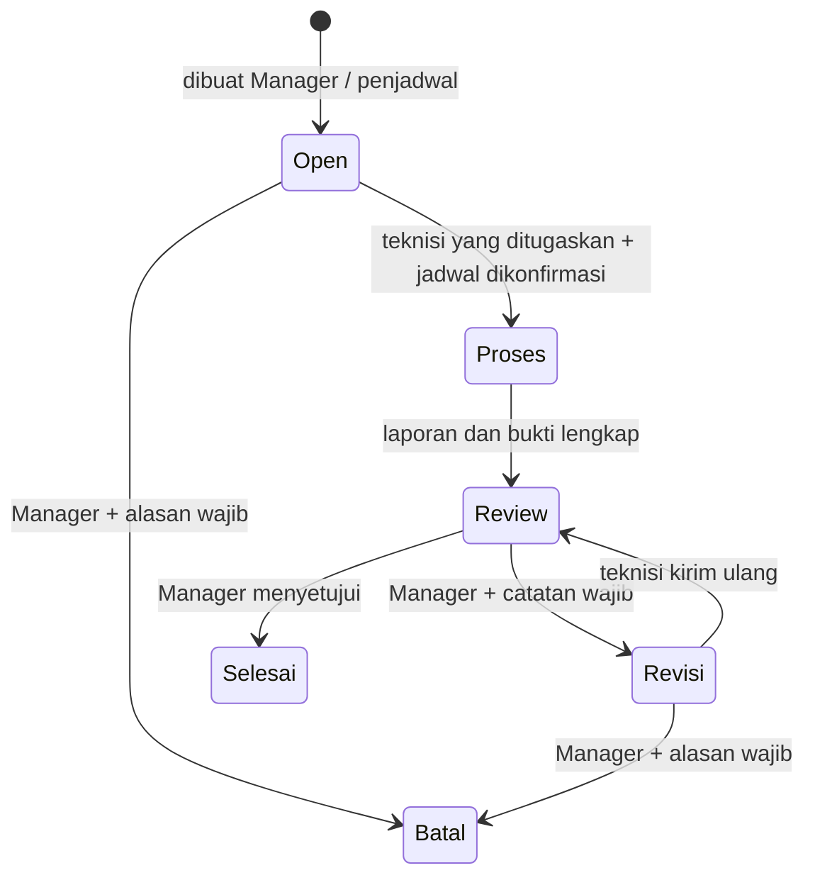

# Arsitektur dan batas MVP

VOMANTIS memakai Django server-rendered templates. Tampilan memakai CSS Corona Admin dan penyesuaian `static/app.css`; JavaScript lokal hanya menangani menu mobile, konfirmasi penonaktifan, serta penambahan kartu. Tidak ada CDN atau integrasi pihak ketiga yang diperlukan saat aplikasi berjalan.

## Hak akses

| Tindakan | Manager / superuser | Teknisi |
| --- | --- | --- |
| Lihat master mesin dan QR | Ya | Ya |
| Tambah, edit, nonaktifkan mesin | Ya | Tidak |
| Semua tiket / kanban / jadwal | Ya | Hanya tiket sendiri |
| Buat, konfirmasi, assign tiket | Ya | Tidak |
| Mulai dan kirim laporan | Hanya jika juga ditugaskan sebagai teknisi | Hanya tiket sendiri |
| Approve atau revisi laporan | Ya | Tidak |
| Lampiran laporan | Semua | Hanya tiket sendiri |
| KPI, data sumber, arsip, CSV | Ya | Tidak |
| Kelola akun melalui Django Admin | Superuser | Tidak |

Pemeriksaan dilakukan di view/service server; menyembunyikan tombol bukan satu-satunya pembatasan. Semua mutasi memakai POST dan CSRF. Foto mesin juga disajikan melalui view yang membutuhkan login. Lampiran historis `bukti_link` tetap disimpan sebagai teks tanpa mengambil atau mengeksekusi konten eksternal.

## Transisi tiket

Perubahan status kritis memakai transaksi dan conditional update agar tindakan usang tidak menimpa status baru. Laporan terkunci saat Review/Selesai. Saat persetujuan, waktu selesai dan verifikator tercatat, kondisi mesin diperbarui, dan PM terkait ditandai terlaksana. Mesin yang sudah afkir tetap afkir.

## Jadwal

Scheduler memakai kunci unik `asset_id:YYYY-MM`. Pemanggilan ulang tidak menggandakan tiket. Hari diambil dari tanggal acuan mesin dan dibatasi hari terakhir bulan. Bulan sebelum tanggal acuan tidak dibuat. Penjadwal hanya membuat usulan jadwal; Manager tetap mengonfirmasi dan menugaskan.

## Bukti dan revisi

Laporan berisi minimal satu kartu, maksimal 20 kartu. Bukti sebelum/sesudah dan bukti kerusakan/perbaikan setiap kartu wajib ada saat dikirim. Saat revisi, bukti lama masih berlaku jika tidak diganti; unggahan baru menambah bukti, tidak menghapus bukti sebelumnya. Snapshot setiap pengiriman/review melindungi isi versi sebelumnya. Snapshot dapat diperiksa pada TicketEvent di Django Admin.

## Batas implementasi

- Notifikasi berupa badge review dan jejak aktivitas di aplikasi; belum memakai email, push, atau polling real-time.
- Dashboard mengikuti perubahan saat halaman dimuat ulang.
- Pengukuran KPI, downtime, dan histori kerusakan dapat ditambah melalui Data & arsip. KPI belum menarik jam operasi dari sensor; durasi downtime tidak disamakan secara otomatis dengan lama tiket terbuka.
- Penjadwalan belum memperhitungkan shift dan kalender produksi; satu tiket aktif terkonfirmasi per teknisi per hari adalah aturan benturan MVP.
- Upload video memakai signature container dan ekstensi, bukan transcoding atau pemeriksaan malware. Batas request server produksi perlu menyesuaikan jumlah lampiran.
- SQLite digunakan sementara; diperlukan evaluasi concurrency dan migrasi database ketika volume penulisan meningkat.
- AI untuk rekomendasi jadwal dan diagnosis merupakan fitur masa depan, tidak disimulasikan sebagai hasil nyata.
